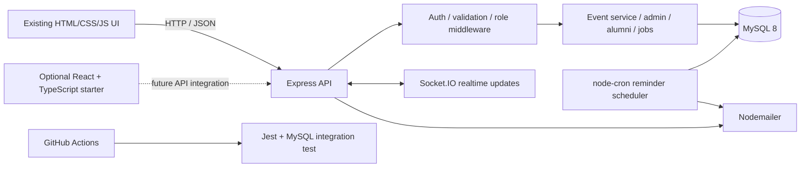

# CampusBridge — Student Event Registration & Alumni Portal

A student-focused campus portal built with **Node.js, Express, MySQL and Socket.IO**. It supports event discovery, capacity-aware registration, FIFO waitlists, QR tickets/check-in, alumni and jobs features, admin reporting, analytics and email reminders. This repository now also includes a test harness, CI workflow, Docker setup, an OpenAPI reference, and an optional React + TypeScript UI starter.

> **Status note:** The original HTML/CSS/JavaScript frontend remains the default production UI and existing API. `frontend-react/` is a separately runnable redesign starter; its sample event cards are demo data and its Details button is deliberately marked as not yet connected to the API. Do not describe the React starter as a complete replacement until authentication, API calls, error handling and all existing screens have been migrated.

## Features

- Express API and MySQL persistence.
- Student, alumni and administrator roles, authentication and email verification/reset flows.
- Event listings, registrations, event capacity and FIFO waitlist promotion.
- Transaction-based registration flow that locks the event row before checking capacity.
- QR ticket generation and admin check-in support.
- Socket.IO seat updates.
- Admin reporting and Chart.js analytics.
- Scheduled reminder job; configure SMTP to send real email (otherwise development previews are printed to the server console).
- Jest tests, including an opt-in MySQL integration test that submits 50 concurrent registrations against a capacity-10 event.
- Docker Compose, GitHub Actions CI, Swagger UI and OpenAPI JSON.

## Prerequisites

- Node.js 20 or later (Node 20 LTS recommended)
- MySQL 8.0
- Git (recommended)
- Docker Desktop only if using the container setup

## Run locally on Windows

1. Extract this repository and open PowerShell in the project folder.
2. Install packages:
   ```powershell
   npm install
   ```
3. Create `.env` from `.env.example` and set the MySQL details and long random JWT secrets. Never commit `.env`.
4. Create/prepare the schema. For a fresh database, use your MySQL client to run `db/schema.sql`. If you already have data, take a backup and apply only the required migrations; do not reset a database containing records you need.
5. Start the API and frontend:
   ```powershell
   npm run dev
   ```
6. Open `http://localhost:5000`. Health check: `http://localhost:5000/api/health`. API docs: `http://localhost:5000/api-docs`.

Email verification in DEV mode prints the verification link in the server terminal. To deliver real messages, configure `SMTP_HOST`, `SMTP_PORT`, `SMTP_USER`, `SMTP_PASS` and `MAIL_FROM` in `.env`.

## Automated tests

### Basic test suite
```powershell
npm test
```

### Real 50-concurrent-registration integration test

**Only run this against a disposable database whose name includes `test`.** It inserts 50 temporary users and a capacity-10 event, invokes the real event service concurrently, and checks that exactly 10 are confirmed and 40 are waitlisted. It refuses to run unless `DB_NAME` contains `test` and `RUN_DB_INTEGRATION=1`.

1. Create an isolated database, for example `student_portal_test`.
2. Apply a test-specific copy of `db/schema.sql` with the database name changed to `student_portal_test`.
3. Set the following environment variables in the same PowerShell session:
   ```powershell
   $env:DB_NAME = 'student_portal_test'
   $env:RUN_DB_INTEGRATION = '1'
   $env:DB_HOST = '127.0.0.1'
   $env:DB_PORT = '3306'
   $env:DB_USER = 'your_test_db_user'
   $env:DB_PASSWORD = 'your_test_db_password'
   $env:JWT_ACCESS_SECRET = 'test-access-secret-long-enough-123'
   $env:JWT_REFRESH_SECRET = 'test-refresh-secret-long-enough-123'
   npm run test:integration
   ```

The CI workflow starts an isolated MySQL service and runs the integration test automatically on pushes and pull requests. The concurrency test exercises the database-backed service rather than mocking the locking behavior.

## Docker Compose

1. Copy `.env.example` to `.env`.
2. Set a strong `DB_PASSWORD`, `MYSQL_ROOT_PASSWORD`, `JWT_ACCESS_SECRET` and `JWT_REFRESH_SECRET`. Set `CLIENT_ORIGIN=http://localhost:5000` for local use.
3. Start containers:
   ```powershell
   docker compose up --build
   ```
4. Visit `http://localhost:5000/api/health` and `http://localhost:5000/api-docs`.

Docker Compose maps MySQL to host port **3307** to avoid colliding with a locally installed MySQL on 3306. The application container talks to the `db` service on internal port 3306. The database volume persists between restarts. `docker compose down -v` deletes persistent data; use it only if you intentionally want to destroy the Docker database.

## React + TypeScript UI starter

The optional redesign lives in `frontend-react/` and does not replace the existing frontend yet. To run it locally:
```powershell
cd frontend-react
npm install
npm run dev
```
Vite serves the prototype at `http://localhost:5173`. This is a UI prototype, not the deployed app; its cards use sample data. The next migration tasks are to connect it to the existing `/api/events` endpoint, implement authentication/session handling, registration and cancellation, and port the remaining student/admin/alumni screens before switching production traffic.

## Architecture



## Deployment readiness

`Dockerfile`, `docker-compose.yml` and `render.yaml` provide deployment starting points. The Render blueprint expects a separately provisioned managed MySQL database; populate its `DB_HOST`, `DB_NAME`, `DB_USER`, `DB_PASSWORD` and `CLIENT_ORIGIN` values in the hosting dashboard. Set JWT secrets and SMTP credentials through the host's secret/environment settings. Do not commit production credentials.

Before public release:
- Use a managed MySQL instance with backups and TLS where supported.
- Configure a real domain and HTTPS.
- Configure SMTP and verify email delivery.
- Apply schema changes as reviewed migrations.
- Confirm the admin account setup process, role permissions and registration concurrency test.
- Check `/api/health`, `/api-docs`, login, event registration, QR check-in and reminder behavior on the deployed host.
- Add screenshots of your own running app to the README after you capture them; none are fabricated in this repository.

## API reference

Run the app and open `http://localhost:5000/api-docs`. The source OpenAPI document is `docs/openapi.json`. It documents the main health, login, event listing, registration, cancellation and ticket routes. As endpoints evolve, update the spec alongside the route implementation.

## Repository layout

```text
config/                 Environment and MySQL connection
routes/                 Express route modules
services/               Event logic, realtime and reminders
middleware/             Authentication, validation, rate limits and errors
client/                 Current working frontend
frontend-react/         Optional React + TypeScript UI starter
db/schema.sql           MySQL schema
 db/upgrade-features.sql Feature migration for existing databases
tests/                  Jest and concurrency integration tests
docs/openapi.json       OpenAPI 3.0 specification
.github/workflows/ci.yml GitHub Actions CI
Dockerfile              Production container image
docker-compose.yml      Local app + MySQL
render.yaml             Hosting blueprint starter
```

## Security notes

- Keep `.env`, access tokens, database credentials and SMTP credentials out of Git.
- Use separate development, test and production databases.
- Never run destructive reset scripts against a database with data you need.
- Review and pin dependency versions and run `npm audit` before publishing.
- Swagger describes the core routes, not every endpoint; treat the implementation as authoritative when details differ.


## React frontend (CampusBridge UI)

The React + TypeScript frontend is in `frontend-react/`. It connects to the same Express API and MySQL database. Start the backend from the project root with `npm run dev`, then in a second terminal run `cd frontend-react`, `npm install`, and `npm run dev`; open `http://localhost:5173`. The original `client/` pages remain as a fallback. To serve the built React app from port 5000, run `npm run build` inside `frontend-react`; when `frontend-react/dist/index.html` exists, Express serves the React build. See `frontend-react/README.md` for details.
